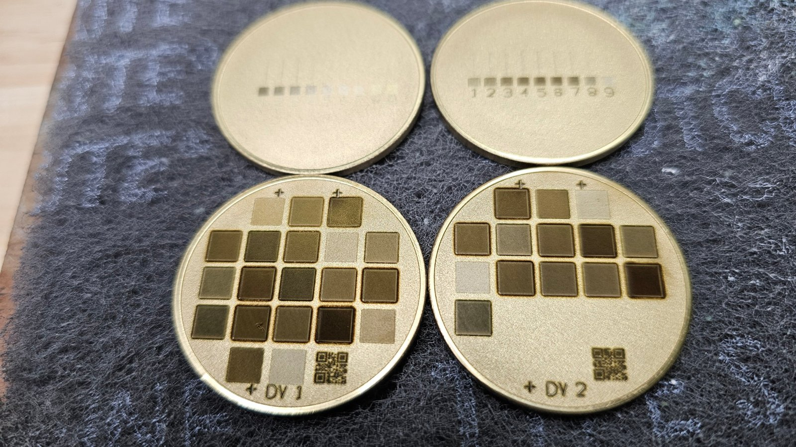
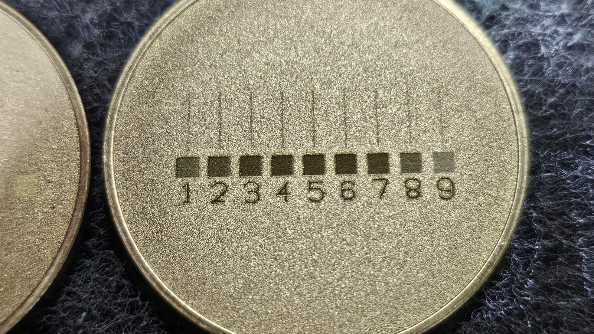
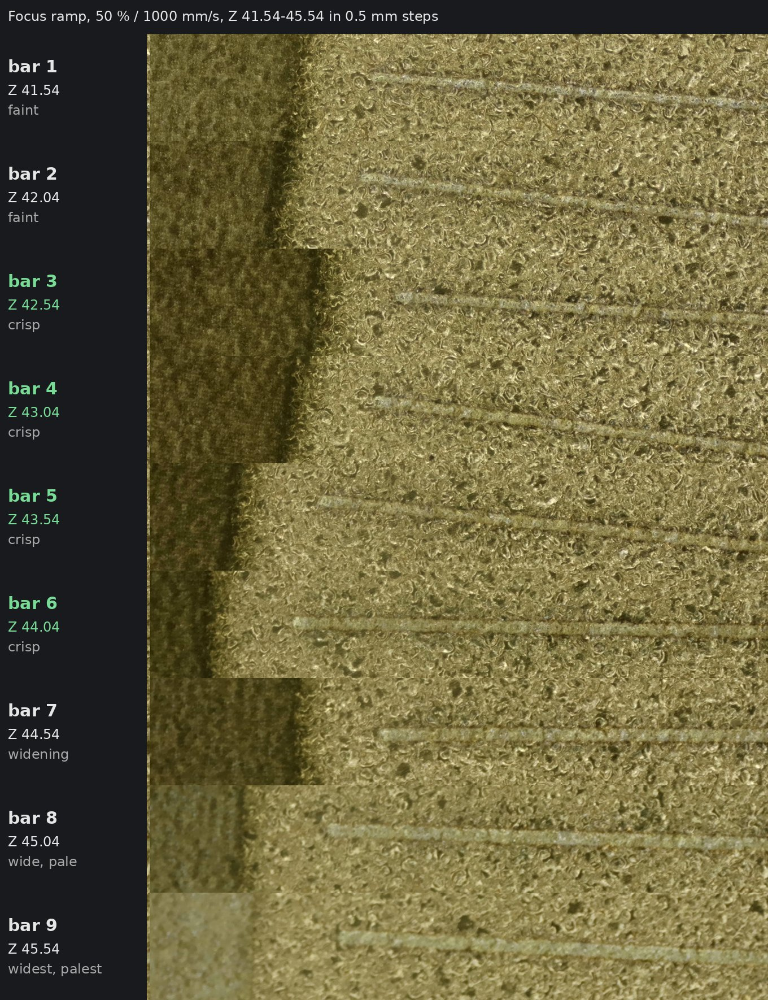
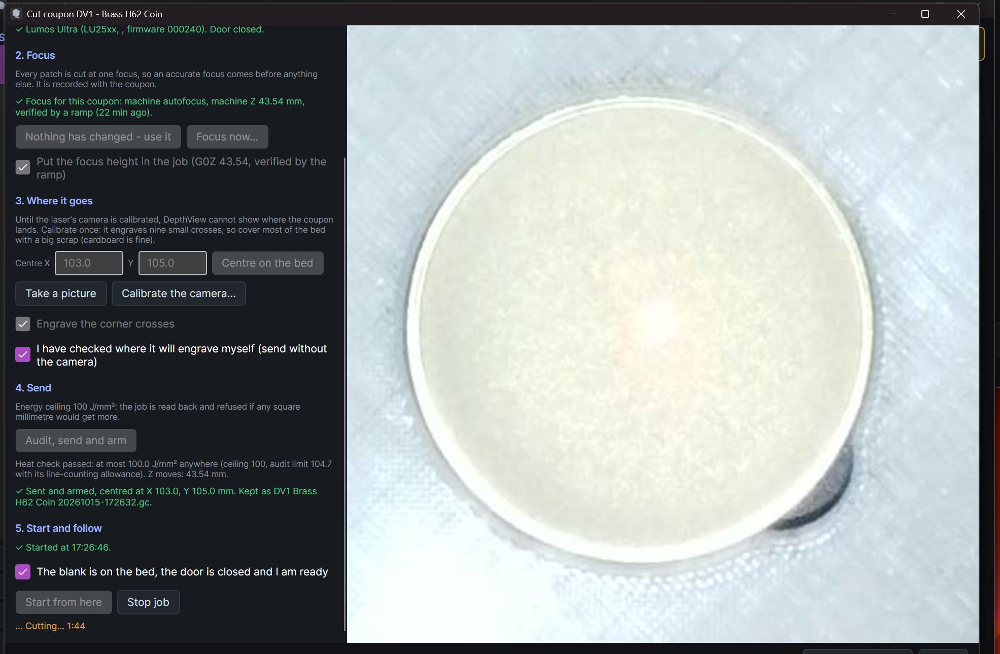
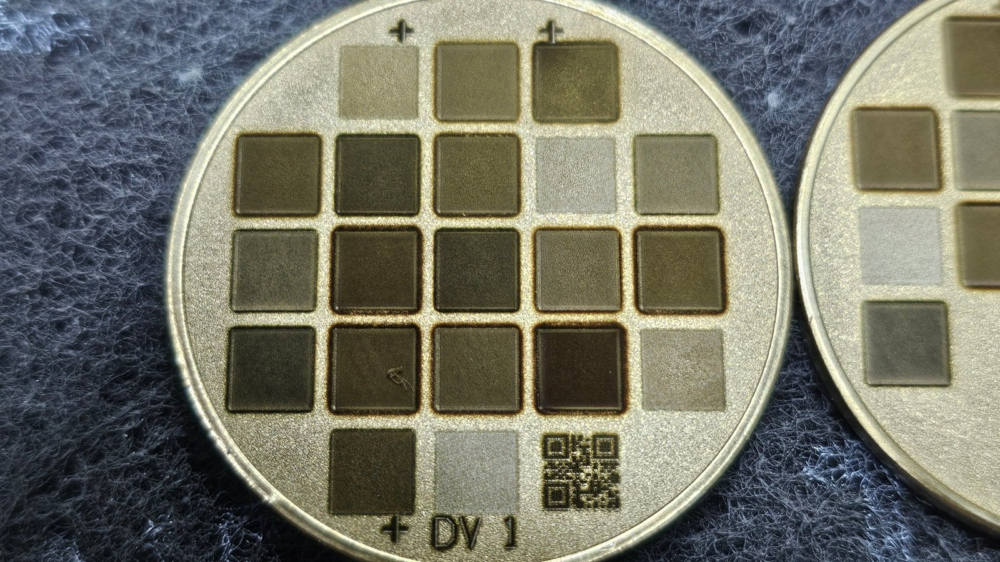

# Precision focus: finding the true focus height with a focus ramp

*An Isotope NW tool guide - DepthView ablation study. Written from the first bench session
on a WeCreat Lumos Ultra (100 W MOPA, red lens), 2026-10-15.*

Removal depends on focus more than on any other setting. A few tenths of a millimetre out and
every patch removes less metal, lines get wider and softer, and a whole study - or a whole run
of production coins - is quietly biased. This guide shows how to find the focus height **as a
number in the machine's own Z coordinates**, verified by what the beam actually does to your
material, so it can be put straight into every job for that blank thickness from then on.

## In one paragraph

Cut a **focus ramp**: a row of numbered bars, each cut at a different machine Z, one single
line and one small square per bar. Under magnification, find the run of bars whose lines are
**crisp, narrow and dark**, with the marks getting worse on **both** sides of it. The middle
of that run is your focus. If the best bars are at either end of the ramp, the focus is
outside it: move the ramp and cut again. Expect to need **two or three ramps** (two or three
coin faces of scrap) the first time. Once you have it, that Z belongs to that laser, lens,
bed/jig and blank thickness, and it does not change.

## Why this is better than the usual ways

Most ways of focusing a fibre laser find where the machine *believes* focus is, or where the
eye *thinks* it is. A ramp measures where the beam really is sharpest, on your material, at
your blank's height, and expresses it in the number the jobs use.

| Method | What it really finds | Typical accuracy (our estimate) |
|---|---|---|
| Focus card, ruler or the two red dots meeting, by eye | where the pointer beams cross - an alignment set at the factory | ±0.3 to ±0.5 mm, depends on the eye and the light |
| Machine autofocus / MakeIt **focus assist** | a height the machine measures and then applies its own idea of focus to | very repeatable (it reported ±0.04 mm), but any offset between its idea of focus and the true beam waist is invisible to it |
| Classic "slanted board" ramp (one long line on a tilted scrap) | the narrowest point of one continuous line | ±0.2 to ±0.5 mm: the tilt is hard to know exactly and the narrowest point is a judgement along a blur |
| **DepthView stepped focus ramp, bracketed** | the centre of the zone where the beam marks crisply, in the machine's own Z | ±0.25 mm with 0.5 mm steps; about ±0.1 mm with a fine 0.1 mm ramp around it |

The accuracy figures are **estimates**, not measurements - honest guesses from how each
method works and what we saw on the bench. What we did measure: on our machine the ramp's
crisp zone was centred **about 2 mm away** from the `G0Z` MakeIt itself writes after its
focus assist (MakeIt: 45.54; ramp: 43.54). Whether that is an error in MakeIt's focus, or an
offset MakeIt applies on purpose for depth work, is not yet known; it will be settled by
depth measurement (see [What is still open](#what-is-still-open)). Either way it shows why a
focus you can *see* on the metal beats one you are told.

What makes the stepped ramp better:

- **It measures the beam, not a proxy.** Pointer beams, cameras and distance sensors are
  calibrated stand-ins for the beam. The ramp's marks *are* the beam.
- **It brackets the focus from both sides.** One sharp line tells you where it looked good; a
  ramp shows where it stops looking good on both sides, and the focus is the middle. Finding
  the middle of a 1.5 mm wide zone is far more precise than spotting the single best line.
- **Each bar is a known, exact height.** The head is moved to each bar's Z by the job itself
  (`G0Z`), so there is no tilt to estimate and no ruler to read.
- **The answer is the number the jobs use.** It is a machine Z, recorded with the laser, lens
  and thickness, and every later job puts the head there itself. Nothing to re-measure, no
  knob to set by eye.
- **It is on the record.** DepthView keeps the ramp job, the bar you chose and your notes with
  every coupon cut at that focus.

## Before you start

You need:

- **Scrap blanks of exactly the thickness you will engrave.** A ramp is a strip about 27 mm
  wide and 12 mm tall; one fits across a 40 mm coin. Both faces of a scrap coin can carry a
  ramp, but **never compare bars on different faces** - the two faces of our blanks marked
  quite differently at the same Z.
- **The jig or bed position you will use for real work.** Focus is a height above the bed;
  if the jig changes, the focus changes.
- **A microscope or a strong loupe.** A USB microscope is ideal: you will be comparing lines
  a tenth of a millimetre wide. Keep the same magnification and lighting for every bar.
- **A starting Z** - see the next section. This is the step that tripped us up most.

### Measure the surface you will engrave, not the rim

Rimmed coin blanks are thicker at the rim than in the field. Our "2 mm" blanks measured
**2.27 mm** with calipers - but calipers sit on the rim. The field (where you engrave) is
lower, roughly 2.13 mm on ours, and the field inside the rim was 37.38 mm across on a 40 mm
blank. Focus on the field, and keep everything you cut inside the rim.

## Step 1 - get a starting Z the machine really uses

The ramp needs a starting height **in machine Z**: the number a job's `G0Z` line moves the
head to. Several numbers on screen look like it and are not:

- **MakeIt focus assist** shows a number like **2.2** (that was the material height it
  measured - close to our coin's thickness) and a small number flickering around zero
  (−0.04, +0.02...: how far it is from its own target). **Neither is the machine Z.**
- **DepthView's "Read Z from the laser"** asks the laser's camera for its height. On the
  Lumos Ultra it is slow and answered all zeros every time (`distance 0.0, height-z 0.0`);
  DepthView now says "no measurement" when that happens. Do not rely on it.
- **The number that is right** is the `G0Z` near the top of a **relief / depth job** that
  MakeIt wrote after focusing on your blank:
  1. Put the blank in place and run MakeIt's focus assist on the field.
  2. Make any small relief (depth) job in MakeIt and **send** it to the laser. You do not need
     to cut it - cancel it on the machine.
  3. Open `%APPDATA%\Wecreat MakeIt!\gcode\gcode.gc` in a text editor. Near the top is a line
     like `G0Z45.54`. That number is your starting Z. (MakeIt overwrites this file on every
     send, so read it straight away.)

On our machine that was **45.54**. Note that the machine Z can be any value, including a
negative one; DepthView accepts both.

## Step 2 - put the ramp where the blank is

The ramp is cut at the **Centre X / Y set in the cut window**, not wherever the red pointer
happens to be. Our first ramp was armed for the middle of the bed (X 105, Y 105, the default)
while the coin sat elsewhere; we caught it by checking the red dot before pressing Start.

- Set **Centre X / Y** in the cut window to where the blank sits. Ours ended up at
  X 103.0, Y 105.0: the first ramp showed a left margin twice the right, which is a 2 mm
  offset.
- Better: **calibrate the camera once** (Calibrate the camera..., nine small crosses on a
  scrap that covers the bed, at about the height you work at). The cut window then draws the
  coupon on the camera picture and you drag it onto the blank.
- **Always check the red dot sits on the blank before pressing Start.**

## Step 3 - cut a coarse ramp around the starting Z

In the cut window press **Focus now...**:

1. **How**: a few words for the record (e.g. "MakeIt focus assist on the field").
2. **Machine Z**: your starting Z from step 1. Press **Tab** - the box only takes a typed value
   when you leave it.
3. Ramp settings for a first, coarse look:
   - **± range 2.00, step 0.50** → 9 bars, 4 mm of Z in total;
   - **power 50 %, speed 1000 mm/s.** Do not use more: at 80 % / 200 mm/s every bar within a
     millimetre of focus marked equally hard and the peak disappeared.
4. Read the **plan line** under the settings. It must say *9 bars ... centred at X..., Y...:
   Z from ... to ...*. Check both the position and the Z band.
5. Tick the clearance box (it names the X/Y and the Z band you are agreeing to), press
   **Audit, send and arm**, check the red dot is on the blank, then **Start**.

Bar 1 is the lowest Z, bar 9 the highest; the numbers are engraved under the bars.

## Step 4 - read the ramp

Look at the **single lines**, bar by bar, at one magnification. Ignore colour as much as you
can; read the line.

**At and near focus** the line is narrow, dark, with clean straight edges. **Away from focus,
on either side,** it changes: on one side the line widens and turns pale and soft; on the other
it thins out and fades as the spread beam stops having enough energy to mark. The focus is the
**middle of the run of crisp bars** - with worse bars on both sides of it.

Our fourth ramp (Z 41.54-45.54, above): bars 1-2 faint and thin, **bars 3-6 crisp**, bars 7-9
widening and pale. The crisp zone runs from 42.54 to 44.04.

**Common mistakes, all of which we made:**

- **"The brightest, cleanest-looking square is the focus."** Not on this brass. The squares at
  focus came out **darkest** (a tight spot removes and darkens the surface); the pale, frosted,
  pretty squares were the *out-of-focus* end. Our first two ramps were misread this way and
  sent us the wrong direction.
- **The best bar is at the end of the ramp.** Then you have not found the focus, only the edge
  of the ramp. A real focus has worse bars on *both* sides. Move the ramp toward the better end
  and cut again.
- **Comparing faces.** Bar 1 of one ramp and bar 5 of another, at the same Z, looked nothing
  alike - because they were on different faces of the blank.
- **Too much power.** It saturates: everything within a millimetre marks the same.

### What to do with what you see

| What you see | What it means | Next ramp |
|---|---|---|
| Crisp bars in the middle, worse on both sides | Focus found | Done, or a fine ramp to sharpen it |
| Best bars at the **low-Z end** (bar 1) | Focus is below the ramp | Starting Z lowered by about 2 mm |
| Best bars at the **high-Z end** (bar 9) | Focus is above the ramp | Starting Z raised by about 2 mm |
| All bars alike | Z moves are not doing anything, or power is too high | Lower power; if still alike, **do not put Z in jobs** |

This is why it can take **three coins**: a first ramp around MakeIt's number, a second shifted
toward the better end, and a third that brackets the focus. Ours took four, because we misread
the first two.

### Optional - a fine ramp

Around the centre of the crisp zone, cut **± range 0.50, step 0.10** (11 bars) at the same
power and speed. The crisp zone will show again, now in 0.1 mm steps, and its middle is your
focus to about ±0.1 mm.

## Step 5 - record it

Back in the focus window:

1. **Sharpest bar**: the bar at the middle of the crisp run. The window shows the resulting
   focus Z.
2. Tick **The bars visibly differ** - this is what marks the focus as *verified*. Only a
   verified focus is put into jobs by default.
3. **Notes**: which ramp, its settings and range, which bars were crisp, and the MakeIt `G0Z`
   you started from. Ours: *"Ramp 4, 50%/1000, 41.54-45.54 step 0.5: crisp lines bars 3-6,
   centre bar 5. Ramps 1-3 agree. MakeIt depth-job G0Z was 45.54."*
4. **Record this focus.**

## Step 6 - use it, forever (for that setup)

From now on the cut window offers **Nothing has changed - use it**, and with **Put the focus
height in the job (G0Z ..., verified by the ramp)** ticked, every job DepthView sends starts by
moving the head to that Z itself. No focus assist, no red dots, no knob.

The focus stays valid as long as these stay the same:

- the **laser and lens**;
- the **bed and jig height** - put the jig back in exactly the same place (a stop or pin
  helps);
- the **blank thickness** - DepthView keeps one focus per laser, lens and thickness, so a 3 mm
  blank gets its own ramp.

If any of these change, or you ever doubt it, a quick 3-bar check (± range 0.50, step 0.50)
around the recorded Z costs one scrap face and a minute.

**Production jobs.** Jobs sent from DepthView carry the Z themselves. For jobs made in MakeIt,
MakeIt applies its own focus; the equivalent would be to shift MakeIt's focus by the
difference between its `G0Z` and the ramp's (2.00 mm in machine Z on our machine). How best
to enter that in MakeIt is not yet confirmed, and the difference should first be confirmed by
depth measurement (below).

## The first bench session, for the record

| Ramp | Z range (step) | Power / speed | What we saw |
|---|---|---|---|
| 1 | 44.54-46.54 (0.25) | 50 % / 1000 | Squares fading from dark (bar 1) to pale (bar 9); lines too faint to read. |
| 2 | 45.54-47.54 (0.25) | 50 % / 1000 | Same trend, on the other face of the coin. |
| 3 | 43.54-47.54 (0.50) | 80 % / 200 | Bars 1-5 strong; bar 6 onward fading and breaking up. Too much power to show a peak. |
| 4 | 41.54-45.54 (0.50) | 50 % / 1000 | Bars 1-2 faint, **3-6 crisp**, 7-9 wide and pale. Focus bracketed. |

Recorded: **Z 43.54** (bar 5), verified. The centre of the crisp run (bars 3-6) is strictly
43.29, so the recorded value is within the crisp zone but may be up to 0.25 mm high; the fine
ramp will settle it. The first two study coupons, DV1 (20 settings) and DV2 (14), were then cut
at G0Z 43.54, both fully inside the field of 40 mm rimmed brass blanks; the coins were barely
warm afterwards.

## What is still open

- **Confirm the 2 mm with depth.** Cut two identical patches on scrap, one at Z 43.54 and one at
  MakeIt's 45.54, and measure their depth with the dial indicator. If 43.54 is clearly deeper and
  cleaner, the ramp's focus is confirmed - and MakeIt depth jobs on this machine have been
  running about 2 mm from best focus.
- **Fine ramp** (0.1 mm steps) around 43.3-43.5.
- **Which direction is "up"?** We have not confirmed whether a higher machine Z moves the head
  away from or toward the bed; the method does not need to know, but production advice will.
- **Reading the Z from the machine.** The camera height endpoint returns zeros on the Ultra;
  reading the `G0Z` from MakeIt's last job is the reliable source today, and could be automated.
</content>
</invoke>
